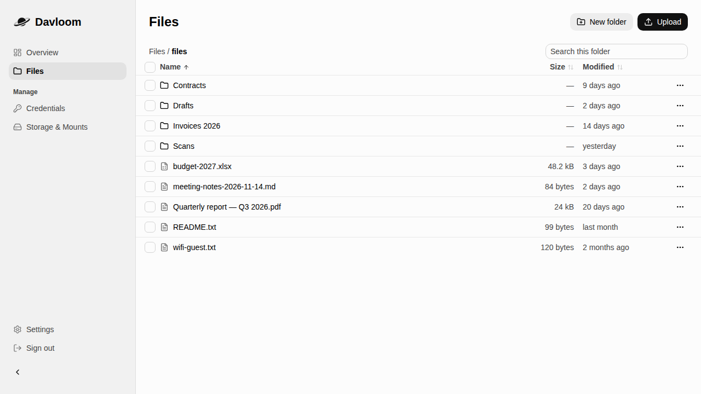
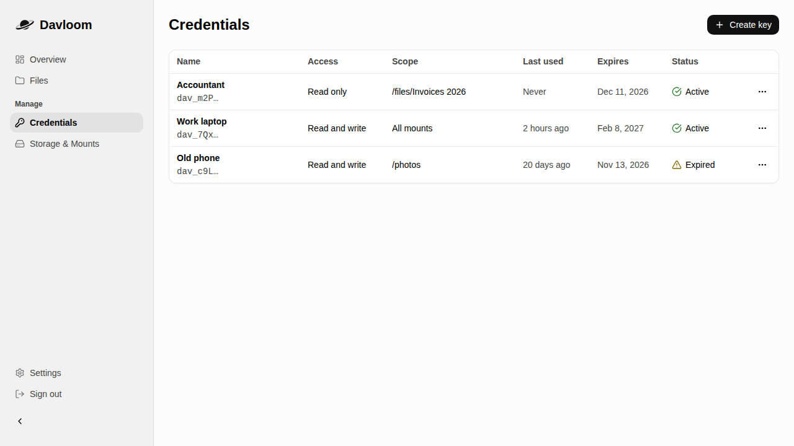
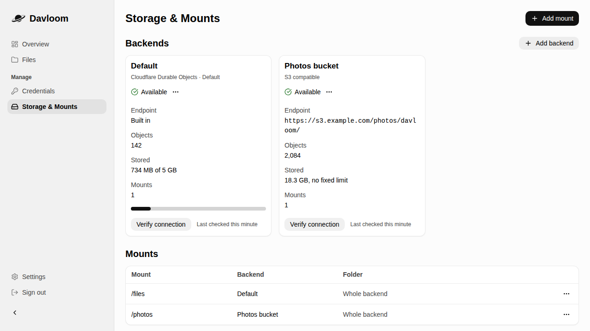
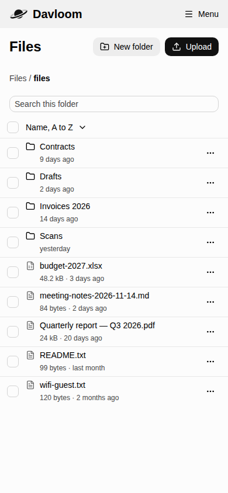

<div align="center">

<h1>
  <picture>
    <source media="(prefers-color-scheme: dark)" srcset="docs/assets/davloom-logo-dark.svg">
    
  </picture>
</h1>

<p><strong>Your own WebDAV drive, free on Cloudflare Workers or self-hosted with Docker.</strong></p>

[](https://github.com/MarkChu-git/davloom/actions/workflows/ci.yml)
[](docs/architecture/overview.md)
[](https://bun.sh)
[](docs/deployment/cloudflare.md)

[](https://deploy.workers.cloudflare.com/?url=https://github.com/MarkChu-git/davloom)

</div>

Davloom is an open-source WebDAV storage server with a web Dashboard. It runs for free on
Cloudflare Workers, with no payment method, or self-hosted with Docker on Bun, SQLite and any
S3-compatible storage such as RustFS. Mount it in Finder, Windows Explorer, rclone or any other
WebDAV client, and manage it from the browser.

<p align="center">
  <picture>
    <source media="(prefers-color-scheme: dark)" srcset="docs/assets/screenshots/files-dark.png">
    
  </picture>
</p>

<table>
  <tr>
    <td width="40%" valign="top">
      <picture>
        <source media="(prefers-color-scheme: dark)" srcset="docs/assets/screenshots/credentials-dark.png">
        
      </picture>
      <p align="center"><sub>API Keys, each with its own access and scope</sub></p>
    </td>
    <td width="40%" valign="top">
      <picture>
        <source media="(prefers-color-scheme: dark)" srcset="docs/assets/screenshots/storage-dark.png">
        
      </picture>
      <p align="center"><sub>Storage backends and the Mounts that publish them</sub></p>
    </td>
    <td width="20%" valign="top">
      <picture>
        <source media="(prefers-color-scheme: dark)" srcset="docs/assets/screenshots/phone-files-dark.png">
        
      </picture>
      <p align="center"><sub>On a phone</sub></p>
    </td>
  </tr>
</table>

## Features

- **WebDAV Class 1 and 2**: every RFC 4918 method, LOCK and UNLOCK included, so macOS Finder,
  Windows Explorer, rclone and other clients mount it read-write. It passes every litmus suite.
- **API Keys for clients**: each key is Read Only or Read / Write, may expire, and may be limited
  to some Mounts or folders. The administrator's password never works over WebDAV.
- **Storage backends**: Cloudflare Durable Objects (the free default), Cloudflare R2, and
  S3-compatible storage. A Mount publishes a backend, or a folder in one, at `/dav/<mount>/`.
- **Proven decisions**: the rules that decide an outcome without I/O (namespace operations,
  conditional requests, byte ranges, permissions and key scopes, names) are written in Bend 2 and
  proven; the code that runs is compiled from the code that was proven.
- **A careful Dashboard**: English and Simplified Chinese, light and dark mode, from a phone to a
  wide screen. Two-step verification and passkeys (once `DAVLOOM_URL` names the address) for
  sign-in, and a fresh check of your password, authenticator code or passkey before anything that
  destroys data.

## Quick start

### Cloudflare Workers, with the button

Select **Deploy to Cloudflare** above. Cloudflare copies this repository into your GitHub or
GitLab account, creates the Worker, its D1 database and its Durable Objects on your account, asks
for the secret `DAVLOOM_SECRET` (at least 32 random bytes, for example from
`openssl rand -base64 48`), and deploys. [What the button does](docs/deployment/cloudflare.md#deploy-with-the-button),
and how to add your own domain afterwards.

### Docker

```bash
git clone https://github.com/MarkChu-git/davloom.git && cd davloom
# First write deploy/docker/.env and point Davloom at RustFS, as docs/deployment/docker.md shows.
docker compose -f deploy/docker/compose.yaml up -d
```

Davloom then answers on `http://localhost:3000`, with RustFS beside it. The image is built from
this repository. [Docker](docs/deployment/docker.md) covers the `.env` file, other S3-compatible
stores and running behind HTTPS.

### Cloudflare Workers, by hand

With Bun and Wrangler from a clone of the repository: create the D1 database, apply the
migrations, deploy and set the secret. [Cloudflare Workers Free](docs/deployment/cloudflare.md#deploy-by-hand)
lists the commands and the Free plan's limits.

Whichever way you deploy, open the Dashboard right away and create your account: the first
account becomes the owner, and registration closes for everyone once it exists.

## Connect a client

1. On **Credentials**, create an API Key. Davloom shows the whole key once.
2. Mount `https://<your host>/dav/` in your client. The username can be anything; the password is
   the key.

Finder also takes the bare address, `https://<your host>`: the root answers WebDAV's OPTIONS and
PROPFIND with a redirect to `/dav/`, which Finder follows, while a browser opening it still gets
the Dashboard. Other clients, rclone among them, need the `/dav/` address.

| Client       | How                                                                                                                 |
| ------------ | ------------------------------------------------------------------------------------------------------------------- |
| macOS Finder | Go, Connect to Server (⌘K), `https://<host>` or `https://<host>/dav/`                                               |
| Windows      | Map network drive, `https://<host>/dav/`                                                                            |
| rclone       | `rclone config create davloom webdav url=https://<host>/dav vendor=other user=davloom pass=$(rclone obscure <key>)` |
| Linux        | davfs2 or a file manager's "Connect to server" with `davs://<host>/dav/`                                            |

## Architecture

Davloom follows Hexagonal Architecture with Effect Layers. One Elysia app serves WebDAV at `/dav/*`
and the Dashboard's API at `/api/*`; the WebDAV engine takes a Web standard `Request` and returns a
`Response`, and reaches storage, the database and identity only through Ports. Each runtime brings
its Adapters: D1 and Durable Objects on Workers, SQLite and S3 on Bun. The Dashboard is a
prerendered TanStack Start app built with Astryx. [Architecture](docs/architecture/overview.md)
walks through the parts, and [Moving an instance](docs/deployment/migration.md) shows how to carry
the records of one deployment to another.

## Develop

Everything runs on Bun. See [CLAUDE.md](CLAUDE.md) for the commands and rules and
[docs/ci.md](docs/ci.md) for the checks.

```bash
bun install --frozen-lockfile
bun run check
```

## Security

[docs/security.md](docs/security.md) lists how each security requirement is met and which tests hold
it.

## License

[GNU Affero General Public License, version 3 only](LICENSE) (`AGPL-3.0-only`). If you change
Davloom and let other people use it over a network, you must offer them the source of your version.
